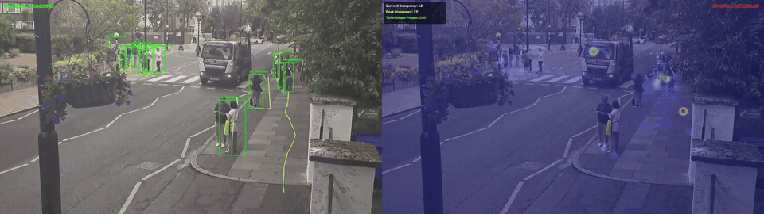
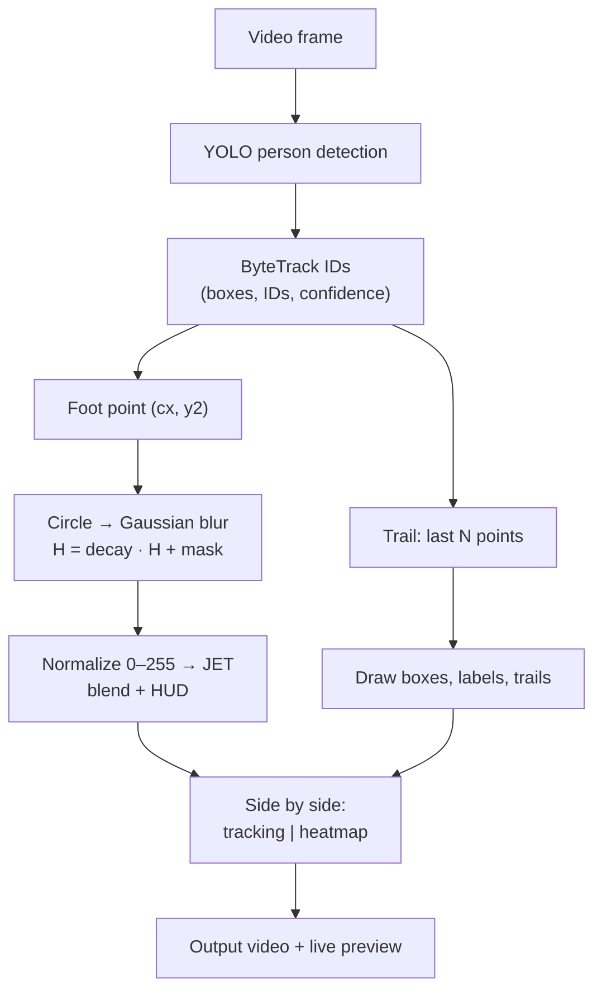

# crowd-heatmap-analytics

Person tracking with YOLO + ByteTrack and a decaying spatial occupancy heatmap, rendered side by side.

The tool reads a video, tracks people frame by frame, and writes a new video at twice the input width: the left panel shows bounding boxes, IDs and short trajectories; the right panel shows where people have been standing or walking, as a heatmap that fades over time, plus a small HUD with current occupancy, peak occupancy and the number of distinct track IDs seen.

<!-- add a short demo GIF here -->


## Features

- Person detection and multi-object tracking (Ultralytics YOLO, ByteTrack by default).
- Foot-point (bottom-center of the box) heatmap with Gaussian smoothing and exponential decay.
- Per-track trajectory trails (last 30 points by default).
- HUD: current occupancy, peak occupancy, total unique track IDs.
- Side-by-side output video (tracking | heatmap), written frame by frame.
- Live preview scaled to fit the screen; press `Q` to stop early (the video written so far is kept).
- File dialogs when no `--input` is given; full CLI for scripted use and headless runs (`--no-display`).
- Optional `--save-heatmap` to export the final accumulated heatmap as an image.

## How it works

For each frame, YOLO detects people and ByteTrack assigns persistent IDs. The foot point of every track is painted as a filled circle on a per-frame float mask, which is blurred and added to an accumulator that decays a little every frame. The accumulator is min-max normalized, colorized with the JET colormap and blended over the frame.



Details, formulas and tuning tips: [docs/how-it-works.md](docs/how-it-works.md).

## Installation

```bash
git clone <repo-url> crowd-heatmap-analytics
cd crowd-heatmap-analytics
python -m venv .venv
# Windows: .venv\Scripts\activate    Linux/macOS: source .venv/bin/activate
pip install -r requirements.txt
pip install -e .            # optional: installs the `crowd-heatmap` command
```

Requires Python 3.9+. A CUDA GPU is strongly recommended: the default model (`yolo26x.pt`) at `imgsz 1920` is slow on CPU. For GPU inference, install a CUDA build of PyTorch first, following the instructions on pytorch.org, then install the requirements. Tkinter (bundled with most Python installers) is needed only for the file dialogs and screen-size detection.

## Results

Example outputs produced by this project (re-encoded to H.264, max 1920 px wide, no audio):

| File | Content |
|---|---|
| [`results/abbey_road_heatmap.mp4`](results/abbey_road_heatmap.mp4) | Pedestrian crossing: tracking (left) and accumulated heatmap with occupancy statistics (right). |
| [`results/street_2_heatmap.mp4`](results/street_2_heatmap.mp4) | Street scene: tracking and heatmap side by side. |
| [`results/street_3_heatmap.mp4`](results/street_3_heatmap.mp4) | Street scene: tracking and heatmap side by side. |

Source footage and attribution: see [results/README.md](results/README.md).

## Usage

```bash
# Interactive: choose input and output with file dialogs
crowd-heatmap

# Scripted
crowd-heatmap --input data/mall.mp4 --output outputs/mall_proc.mp4

# Lighter model, shipped in weights/
crowd-heatmap -i data/mall.mp4 --model weights/yolo26m.pt --imgsz 1280

# Headless, also export the final heatmap image
crowd-heatmap -i data/mall.mp4 -o outputs/mall_proc.mp4 --no-display --save-heatmap outputs/mall_heat.png

# Equivalent module form
python -m crowd_heatmap --help
```

Without `--input`, an open dialog asks for the video and a save dialog proposes `<name>_proc<ext>` next to it. With `--input` but no `--output`, that same default path is used without a dialog.

## Parameters

| Name | Default | Description |
|------|---------|-------------|
| `--input`, `-i` | (dialog) | Input video. If omitted, file dialogs open. |
| `--output`, `-o` | `<name>_proc<ext>` | Output video path. |
| `--model` | `yolo26x.pt` | Ultralytics weights path or official name (auto-downloaded if missing). |
| `--conf` | `0.10` | Detection confidence threshold (low, to keep small or distant people). |
| `--imgsz` | `1920` | Inference image size. |
| `--tracker` | `bytetrack.yaml` | Ultralytics tracker config (`botsort.yaml` also works). |
| `--decay` | `0.995` | Per-frame multiplicative decay of accumulated heat. |
| `--intensity` | `3.5` | Value painted inside each foot-point circle (kept from the prototype; min-max normalization makes it visually neutral, see docs). |
| `--radius` | `18` | Foot-point circle radius in pixels. |
| `--blur` | `35` | Gaussian kernel size (odd). |
| `--alpha` | `0.6` | Weight of the original frame in the blend; the colormap gets `1 - alpha`. |
| `--trail` | `30` | Trajectory length (points) per track. |
| `--save-heatmap` | off | Save the final accumulated heatmap (JET-colored, no frame underneath) to this image path. |
| `--no-display` | off | Do not open the preview window. |
| `--verbose`, `-v` | off | Debug logging. |

## Output

- **Video**: same FPS and height as the input, width x2, `mp4v` codec. Left panel "ORIGINAL TRACKING": green boxes, `ID: n (conf)` labels, yellow trails. Right panel "SPATIAL HEATMAP": colorized heatmap blended over the frame and the HUD (Current Occupancy, Peak Occupancy, Total Unique People). Frames are written continuously, so an early stop with `Q` or Ctrl+C leaves a valid partial video.
- **Preview window** (unless `--no-display`): the same frame, downscaled to fit within 90 % of the screen width and 85 % of the screen height; never upscaled.
- **Heatmap image** (only with `--save-heatmap`): the accumulator at the last processed frame, min-max normalized and JET-colorized, at the input resolution. Because of the decay, it reflects recent activity more than early activity.

## Project structure

```
crowd-heatmap-analytics/
  README.md
  requirements.txt
  pyproject.toml
  docs/
    how-it-works.md
    assets/                 # demo GIF goes here
  weights/
    README.md
    yolo26m.pt              # lighter model (yolo26x.pt is auto-downloaded)
  src/crowd_heatmap/
    __init__.py
    __main__.py             # python -m crowd_heatmap
    cli.py                  # argparse entry point (crowd-heatmap)
    config.py               # Config dataclass with defaults
    dialogs.py              # Tkinter file dialogs, screen size
    pipeline.py             # video loop: track -> heat -> render -> write
    heatmap.py              # HeatmapAccumulator (numpy/OpenCV)
    rendering.py            # boxes, trails, HUD, titles, side-by-side, resize
    layout.py               # fit-to-screen scale ratio (stdlib)
    stats.py                # OccupancyStats (stdlib)
    trajectories.py         # TrajectoryStore (stdlib)
  tests/
    test_layout.py
    test_stats.py
    test_trajectories.py
```

Tests cover the pure-logic modules only and need no third-party packages: `pytest` (or run the test functions directly with `src` on `sys.path`).

## Limitations

- **"Total Unique People" counts tracker IDs, not people.** Every ID switch (occlusion, leaving and re-entering the frame, missed detections) creates a new ID and inflates the count. Treat it as an upper bound, not a head count.
- Current and peak occupancy count only tracked detections in the frame; missed or occluded people are not counted, and false positives (a low `--conf` of 0.10 raises their likelihood) are.
- The heatmap is in image coordinates. There is no perspective correction, so people near the camera cover more pixels than distant ones, and the heat is not comparable across camera views.
- Min-max normalization is per frame: colors are relative to the current maximum, not an absolute density scale, and one very busy spot can wash out the rest.
- With decay 0.995, heat halves in about 138 frames (around 4.6 s at 30 FPS), so the map shows recent activity, not a whole-video total.
- Foot point = bottom-center of the box; partially visible people (cut off at the bottom, sitting, occluded legs) are placed inaccurately.
- Trajectories of IDs that are no longer seen are kept in memory until the end of the run (a few points each).
- Processing is offline and not real-time with the default model and image size on most hardware.
- No result of this tool has been validated against ground truth; outputs are visual analytics aids, not measurements.

## Models & credits

- [Ultralytics YOLO](https://github.com/ultralytics/ultralytics) (YOLO26 weights, tracking API): AGPL-3.0. See [weights/README.md](weights/README.md).
- ByteTrack (Zhang et al., 2022): tracker algorithm, used through the Ultralytics implementation (the original ByteTrack code is MIT-licensed).
- Model trained on the COCO dataset; only class 0 (`person`) is used.
- [OpenCV](https://opencv.org/) (Apache-2.0), [NumPy](https://numpy.org/) (BSD-3-Clause).

## License

AGPL-3.0, because the project depends on Ultralytics, which is AGPL-3.0. See [LICENSE](LICENSE).
